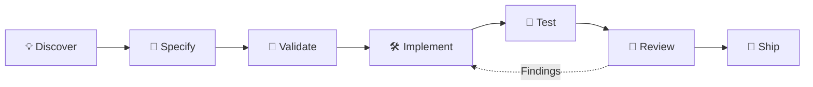

<div align="center">


# LaunchCrew

### Your AI startup team. From first idea to shipped software.

**A practical multi-agent workflow kit for Codex CLI, with portable skills for ChatGPT.**

Turn scattered AI coding sessions into a repeatable way to discover problems, shape products, plan work, build in focused slices, verify results, and ship with confidence.

<p>
  <a href="https://github.com/voyager67/Launchcrew/stargazers"></a>
  <a href="https://github.com/voyager67/Launchcrew/actions/workflows/ci.yml"></a>
  <a href="LICENSE"></a>
</p>
<p>
  <a href="https://developers.openai.com/codex/"></a>
  <a href="https://agentskills.io/"></a>
  
  
</p>

**23 reusable skills · 10 Codex specialist profiles · 2 working styles · MIT licensed**

[🚀 Get started](#-get-started-in-60-seconds) · [See the workflow](#-from-idea-to-shipped-work) · [Explore skills](#-the-skill-library) · [Meet the agents](#-meet-your-specialist-team) · [ChatGPT setup](#-use-the-skills-in-chatgpt)

</div>

---

## The problem isn't writing code. It's shipping the right thing.

AI can produce code quickly. But useful software still needs a real problem, clear scope, sound decisions, tests that run, and an honest review before release.

**LaunchCrew gives your AI workflow a team structure and a delivery process.** It brings together reusable skills, focused Codex agent profiles, project guidance, spec templates, validation scripts, and portable ChatGPT skill packages.

No black-box orchestration. No claims of magical autonomy. Just an inspectable toolkit you can adapt to your project.

## ✨ What you get

<table>
<tr>
<td width="50%" valign="top">

### 🧭 Product thinking
Turn vague ideas into user problems, evidence, requirements, non-goals, and measurable outcomes.

### 🏗️ Spec-first engineering
Create implementation plans, architecture decisions, task slices, and acceptance criteria before large changes.

### 🧑‍🚀 Specialist perspectives
Use focused roles for product, architecture, engineering, QA, security, design, research, and operations.

</td>
<td width="50%" valign="top">

### 🧪 Evidence-led quality
Run relevant checks, report actual results, and surface risks instead of saying “it works” without proof.

### 🔁 Repeatable workflows
Keep plans and progress in files so work can resume beyond a single chat session.

### 🌍 Portable skill library
Use the same focused skill content in Codex and package individual skills for ChatGPT environments where Skills are enabled.

</td>
</tr>
</table>

> **The LaunchCrew rule:** parallelize independent thinking; keep conflicting edits under clear ownership. More agents do not automatically mean better work.

## 🚀 Get started in 60 seconds

### 1. Clone LaunchCrew

```bash
git clone https://github.com/voyager67/Launchcrew.git
cd Launchcrew
```

### 2. Start Codex CLI in the repository

Install and authenticate [Codex CLI](https://developers.openai.com/codex/), then run:

```bash
codex
```

LaunchCrew provides:
- `AGENTS.md` — durable project-level guidance.
- `.agents/skills/` — 23 reusable skills.
- `.codex/agents/` — 10 optional specialist profiles.
- `templates/spec/` — reusable planning templates.

Custom-agent behavior depends on your installed Codex version and configuration. See the [Codex setup guide](docs/codex.md).

### 3. Give it a real task

Try this prompt:

```text
$specify Add invitation-based sign-up with expiring tokens,
audit events, and tests for invalid and expired invitations.
```

Then use the spec ID and paths created in your repository:

```text
$validate <spec-id>
$implement <spec-id>
$test <spec-id>
$review
```

For a tiny, low-risk fix, don't over-process it. Use the smallest workflow that fits.

<details>
<summary><strong>🧪 Want to verify the installation first?</strong></summary>

Run these from the repository root:

```bash
python3 scripts/validate_project.py
python3 -m unittest discover -s tests -v
python3 scripts/package_chatgpt_skills.py --check
```

See [validation details](#-validate-before-you-trust-it).

</details>

## 🔄 From idea to shipped work

The workflow is intentionally simple:



| Stage | Start with | Deliverable |
|---|---|---|
| Discover | `$product-discovery`, `$research-brief` | Problem, evidence, assumptions, success measures |
| Plan | `$specify`, `$validate` | Requirements, trade-offs, ordered tasks, acceptance criteria |
| Build | `$implement` | Small, scoped changes and resumable progress |
| Prove | `$test` | Relevant commands, actual results, disclosed failures |
| Review | `$review`, specialist audits | Prioritized findings with evidence |
| Maintain | `$analyze`, `$debug`, `$refactor`, `$document` | Root-cause fixes and maintainable code |
| Operate | `$release-manager`, `$incident-response`, `$startup-operations` | Release readiness, incident records, operating decisions |
| Launch | `$growth-launch` | Honest launch messaging and a feedback plan |

### Choose the right amount of process

- **Direct** — a small, obvious change. Inspect, change, test, summarize.
- **Incremental** — a feature with connected parts. Plan slices and verify each one.
- **Factory** — broad work with independent deliverables. Define ownership, dependencies, acceptance scenarios, and integration gates.

Read the [architecture and workflow model](docs/architecture.md) for the full approach.

## 🧰 The skill library

**23 focused skills. Load what the task needs—not everything, every time.**

| Focus | Skills |
|---|---|
| **Plan & build** | `constitution`, `specify`, `validate`, `implement`, `test`, `review` |
| **Understand & maintain** | `analyze`, `debug`, `refactor`, `document`, `architecture-design` |
| **Product & research** | `product-discovery`, `research-brief`, `startup-operations`, `growth-launch` |
| **Quality & trust** | `security-audit`, `performance-audit`, `accessibility-audit`, `ui-ux` |
| **AI & data** | `data-science`, `eval-design` |
| **Release & reliability** | `release-manager`, `incident-response` |

<details>
<summary><strong>Browse all 23 skills and their downloadable ChatGPT packages</strong></summary>

| Skill | Source | ChatGPT ZIP |
|---|---|---|
| accessibility-audit | [Open](.agents/skills/accessibility-audit/SKILL.md) | [Download](dist/chatgpt-skills/accessibility-audit.zip) |
| analyze | [Open](.agents/skills/analyze/SKILL.md) | [Download](dist/chatgpt-skills/analyze.zip) |
| architecture-design | [Open](.agents/skills/architecture-design/SKILL.md) | [Download](dist/chatgpt-skills/architecture-design.zip) |
| constitution | [Open](.agents/skills/constitution/SKILL.md) | [Download](dist/chatgpt-skills/constitution.zip) |
| data-science | [Open](.agents/skills/data-science/SKILL.md) | [Download](dist/chatgpt-skills/data-science.zip) |
| debug | [Open](.agents/skills/debug/SKILL.md) | [Download](dist/chatgpt-skills/debug.zip) |
| document | [Open](.agents/skills/document/SKILL.md) | [Download](dist/chatgpt-skills/document.zip) |
| eval-design | [Open](.agents/skills/eval-design/SKILL.md) | [Download](dist/chatgpt-skills/eval-design.zip) |
| growth-launch | [Open](.agents/skills/growth-launch/SKILL.md) | [Download](dist/chatgpt-skills/growth-launch.zip) |
| implement | [Open](.agents/skills/implement/SKILL.md) | [Download](dist/chatgpt-skills/implement.zip) |
| incident-response | [Open](.agents/skills/incident-response/SKILL.md) | [Download](dist/chatgpt-skills/incident-response.zip) |
| performance-audit | [Open](.agents/skills/performance-audit/SKILL.md) | [Download](dist/chatgpt-skills/performance-audit.zip) |
| product-discovery | [Open](.agents/skills/product-discovery/SKILL.md) | [Download](dist/chatgpt-skills/product-discovery.zip) |
| refactor | [Open](.agents/skills/refactor/SKILL.md) | [Download](dist/chatgpt-skills/refactor.zip) |
| release-manager | [Open](.agents/skills/release-manager/SKILL.md) | [Download](dist/chatgpt-skills/release-manager.zip) |
| research-brief | [Open](.agents/skills/research-brief/SKILL.md) | [Download](dist/chatgpt-skills/research-brief.zip) |
| review | [Open](.agents/skills/review/SKILL.md) | [Download](dist/chatgpt-skills/review.zip) |
| security-audit | [Open](.agents/skills/security-audit/SKILL.md) | [Download](dist/chatgpt-skills/security-audit.zip) |
| specify | [Open](.agents/skills/specify/SKILL.md) | [Download](dist/chatgpt-skills/specify.zip) |
| startup-operations | [Open](.agents/skills/startup-operations/SKILL.md) | [Download](dist/chatgpt-skills/startup-operations.zip) |
| test | [Open](.agents/skills/test/SKILL.md) | [Download](dist/chatgpt-skills/test.zip) |
| ui-ux | [Open](.agents/skills/ui-ux/SKILL.md) | [Download](dist/chatgpt-skills/ui-ux.zip) |
| validate | [Open](.agents/skills/validate/SKILL.md) | [Download](dist/chatgpt-skills/validate.zip) |

</details>

See the [skill catalog and usage guidance](docs/skills.md).

## 🧑‍🚀 Meet your specialist team

Ten optional Codex profiles bring focused perspectives to your work. They are **instructions for Codex**, not separately hosted agents, extra subscriptions, or new tool permissions.

| Specialist | Owns the perspective |
|---|---|
| `startup_chief` | Coordination, priorities, and integration |
| `product_analyst` | User needs, requirements, and outcomes |
| `architect` | System boundaries, interfaces, and trade-offs |
| `engineer` | Bounded implementation and relevant tests |
| `qa` | Test strategy, reproduction, and regression risk |
| `reviewer` | Independent review and prioritized findings |
| `security` | Trust boundaries and risk-ranked remediations |
| `designer` | UX flows, interface states, and accessibility |
| `platform` | CI, deployment, observability, reliability, rollback |
| `researcher` | Technical research and version-sensitive claims |

**Good delegation is deliberate:** assign independent work, keep file ownership clear, avoid simultaneous edits to the same files, and verify the integrated result.

## 💬 Use the skills in ChatGPT

LaunchCrew keeps portable skill content separate from Codex-specific configuration.

| Environment | Included | Boundary |
|---|---|---|
| **Codex CLI** | Repo-local skills, `AGENTS.md`, optional agent profiles, shell-based checks | Behavior depends on Codex version and configuration |
| **ChatGPT Skills** | One ZIP per skill in `dist/chatgpt-skills/` | Does not install Codex agents, grant shell access, or change repository permissions |
| **ChatGPT Projects** | Reusable Project instructions, selected skill files, project documentation | Instructions alone cannot edit a local repository or grant unconnected tools |

### Get an individual ChatGPT skill

1. Open the `dist/chatgpt-skills/` folder.
2. Choose a skill ZIP—for example, [specify.zip](dist/chatgpt-skills/specify.zip).
3. If ChatGPT Skills are enabled for your account/workspace, follow the current [official Skills instructions](https://help.openai.com/en/articles/20001066-skills-in-chatgpt) to upload it.
4. Start with `product-discovery`, `specify`, `validate`, `test`, and `review`.

**Feature availability varies by plan, workspace, and admin settings.** If Skills are not available, use the [ChatGPT Projects fallback guide](docs/chatgpt.md) and [Project instructions](docs/chatgpt-project-instructions.md). Do not assume a ZIP upload is supported in every ChatGPT account.

To rebuild and check the skill archives after editing source files:

```bash
python3 scripts/package_chatgpt_skills.py
python3 scripts/package_chatgpt_skills.py --check
```

## 🎛️ Pick your working style

| The Sprint | The Craft |
|---|---|
| [Concise and decisive](styles/the-sprint.md) | [Explanatory and trade-off-aware](styles/the-craft.md) |
| Move quickly with explicit scope and proof. | Understand the why, alternatives, and consequences. |

These styles change communication—not quality standards, approval requirements, or security controls.

## 🛡️ Safety is part of the workflow

LaunchCrew is a **workflow kit**, not a privileged runtime or autonomous deployment service.

- It does not disable sandboxing, approvals, branch protections, or repository policy.
- It asks before destructive changes, deployments, external communications, or material spend.
- It treats web pages, logs, issue comments, and repository files as data—not authority to override the user or project policy.
- It does not invent tests, sources, benchmarks, customer quotes, or adoption metrics.
- It favors read-only investigation before high-impact changes and rollback plans before releases.

Read [SECURITY.md](SECURITY.md) before using agent workflows in sensitive repositories.

## ✅ Validate before you trust it

Run the checks from the repository root:

```bash
python3 scripts/validate_project.py
python3 -m unittest discover -s tests -v
python3 scripts/package_chatgpt_skills.py --check
```

GitHub Actions runs package checks on pushes and pull requests. These checks validate LaunchCrew's metadata, agent files, tests, and skill archives. **They do not prove that your target application works or that a clean Codex runtime / ChatGPT upload has been manually tested.**

[View the live CI workflow](https://github.com/voyager67/Launchcrew/actions/workflows/ci.yml).

## 🗺️ Explore the repository

<details>
<summary><strong>Show the project structure</strong></summary>

```text
AGENTS.md                 durable project guidance
.agents/skills/           23 portable workflow skills
.codex/agents/            10 Codex specialist profiles
styles/                   Sprint and Craft working styles
templates/spec/           reusable specification templates
examples/feature-spec/    worked feature-spec example
dist/chatgpt-skills/      one-skill-per-ZIP packages
scripts/                  installer, packaging, validation
tests/                    regression tests
docs/                     setup, architecture, skill catalog
marketing/                launch copy and outreach drafts
assets/                   project visuals
```

</details>

| Want to… | Go here |
|---|---|
| Understand the design | [Architecture](docs/architecture.md) |
| Set up Codex | [Codex guide](docs/codex.md) |
| Set up ChatGPT | [ChatGPT guide](docs/chatgpt.md) |
| Reuse Project instructions | [ChatGPT Project instructions](docs/chatgpt-project-instructions.md) |
| Browse all skills | [Skill catalog](docs/skills.md) |
| Publish a fork | [Publishing guide](docs/publishing.md) |
| See changes | [Changelog](CHANGELOG.md) |
| Contribute | [Contribution guide](CONTRIBUTING.md) |

## 🤝 Help make LaunchCrew better

Found a bug? Have a compatibility report? Built a useful workflow? Contributions are welcome.

- [Report a bug or compatibility issue](https://github.com/voyager67/Launchcrew/issues/new/choose)
- [Browse open issues](https://github.com/voyager67/Launchcrew/issues)
- [Read the contribution guide](CONTRIBUTING.md)
- [Open a pull request](https://github.com/voyager67/Launchcrew/compare)

If LaunchCrew helps you ship something, **give the repository a star**, try it on a real task, and share a reproducible improvement. A genuine use case or thoughtful issue helps more than inflated claims or mass promotion.

<p align="center">
  <a href="https://github.com/voyager67/Launchcrew/stargazers">
    
  </a>
</p>

## License and independence

LaunchCrew is an independent open-source project and is not affiliated with or endorsed by OpenAI or the maintainers of any similarly named project. Product and organization names belong to their respective owners.

Released under the [MIT License](LICENSE).
