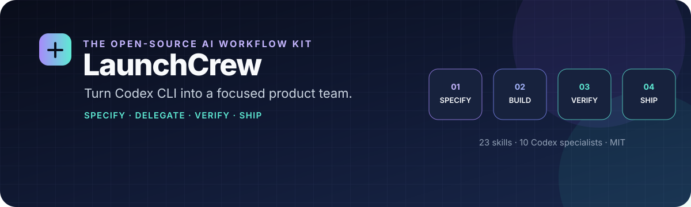

<div align="center">



# LaunchCrew

### Built for **Codex CLI**. Portable workflows for **ChatGPT** where Skills are available.

Turn AI coding sessions into a repeatable product-engineering workflow: clarify the problem, plan the work, delegate independent thinking, test changes, and review evidence before shipping.

[](https://github.com/voyager67/launchcrew/actions/workflows/ci.yml)
[](LICENSE)
[](https://github.com/voyager67/launchcrew/stargazers)
[](https://developers.openai.com/codex/)
[](https://agentskills.io/)

**23 reusable skills · 10 Codex specialist profiles · 2 working styles · MIT licensed**

[Quick start](#-quick-start) · [Workflow](#-the-workflow) · [Skills](#-the-skill-library) · [Agents](#-the-codex-specialist-team) · [ChatGPT](#-chatgpt-support) · [Validation](#-validate-before-you-trust-it)

</div>

---

## Why LaunchCrew?

AI can generate code quickly. Reliable software delivery still needs a clear problem statement, explicit acceptance criteria, bounded implementation, tests that actually run, and an independent review.

LaunchCrew packages those habits into version-controlled instructions you can inspect, adapt, and reuse. It is **more than a prompt collection**, but it is not an opaque autonomous runtime.

### The operating loop

```text
DISCOVER → SPECIFY → VALIDATE → IMPLEMENT → TEST → REVIEW → SHIP
    │           │         │          │        │       │
    └─ problem  └─ scope   └─ plan    └─ slices └─ proof └─ release
       + evidence + criteria + risks    + progress + findings
```

### What makes it useful

| Capability | What LaunchCrew adds |
|---|---|
| **Spec-first delivery** | Requirements, non-goals, design choices, task dependencies, and acceptance scenarios before substantial changes. |
| **Right-sized process** | Direct, Incremental, and Factory workflows—use the lightest process that safely fits the task. |
| **Specialist review** | Distinct Codex roles for architecture, implementation, QA, security, product, design, research, and operations. |
| **Evidence over vibes** | Test commands, findings, sources, assumptions, and limitations are reported explicitly. |
| **Resumable work** | Specs, plans, and progress live in files—not only in chat history. |
| **Portable skill content** | Focused `SKILL.md` workflows can be packaged for eligible ChatGPT Skills environments. |

> **Core principle:** parallelize independent investigation; serialize conflicting edits. Add agents only when ownership and outputs are clear.

## ⚡ Quick start

### 1. Clone the repository

```bash
git clone https://github.com/voyager67/launchcrew.git
cd launchcrew
```

### 2. Open it with Codex CLI

Install and authenticate [Codex CLI](https://developers.openai.com/codex/) first, then run it from the repository root:

```bash
codex
```

The repository includes `AGENTS.md`, 23 skills in `.agents/skills/`, and 10 optional project-scoped agent profiles in `.codex/agents/`. Custom-agent delegation depends on your Codex version and configuration.

### 3. Try a real workflow

```text
$specify Add invitation-based sign-up with expiring tokens and audit events.
```

Then continue with the task ID and paths created by the spec:

```text
$validate <spec-id>
$implement <spec-id>
$test <spec-id>
$review
```

Use the actual spec ID created in your repository. For a one-line fix or another low-risk task, skip heavyweight planning and use the smallest relevant workflow.

## 🧭 The workflow

| Stage | Start with | Expected result |
|---|---|---|
| Discover | `$product-discovery` or `$research-brief` | User problem, evidence, assumptions, and success measures. |
| Plan | `$specify` then `$validate` | Testable requirements, design trade-offs, ordered slices, and acceptance scenarios. |
| Build | `$implement` | Small changes with explicit scope and resumable progress. |
| Prove | `$test` | Relevant checks run with actual output and failures disclosed. |
| Review | `$review` and specialist audits | Prioritized findings tied to code, impact, and evidence. |
| Maintain | `$analyze`, `$debug`, `$refactor`, `$document` | Root-cause fixes, safer structure, and accurate docs. |
| Operate | `$release-manager`, `$incident-response`, `$startup-operations` | Release checks, incident records, or metrics and decisions. |
| Launch | `$growth-launch` | A truthful launch message and a feedback plan—not fake traction. |

### Pick the process size

- **Direct** — a small, obvious change. Inspect, change, test, summarize.
- **Incremental** — a feature with connected parts. Plan ordered slices and verify each one.
- **Factory** — broad work with independent deliverables. Define ownership, dependencies, acceptance scenarios, and an integration gate.

See the [architecture and workflow model](docs/architecture.md).

## 🧰 The skill library

Each skill has a focused trigger, procedural guidance, guardrails, and a defined output. Load only what the task needs instead of attaching all 23 skills to every conversation.

| Area | Skills |
|---|---|
| **Plan & build** | `constitution`, `specify`, `validate`, `implement`, `test`, `review` |
| **Understand & maintain** | `analyze`, `debug`, `refactor`, `document`, `architecture-design` |
| **Product & research** | `product-discovery`, `research-brief`, `startup-operations`, `growth-launch` |
| **Quality & trust** | `security-audit`, `performance-audit`, `accessibility-audit`, `ui-ux` |
| **AI & data** | `data-science`, `eval-design` |
| **Release & reliability** | `release-manager`, `incident-response` |

Browse the [full skill catalog](docs/skills.md). Source files are in [`.agents/skills/`](.agents/skills/).

## 🧑‍🚀 The Codex specialist team

The optional `.codex/agents/` profiles define focused roles. They are instructions for Codex—not separately hosted agents, extra model subscriptions, or new tool permissions.

| Agent | Responsibility |
|---|---|
| `startup_chief` | Coordinates work and integrates findings. |
| `product_analyst` | User needs, requirements, and outcome metrics. |
| `architect` | System boundaries, interfaces, and trade-offs. |
| `engineer` | Bounded implementation slices and relevant tests. |
| `qa` | Test strategy, reproduction, and regression risk. |
| `reviewer` | Independent, read-only review and prioritized findings. |
| `security` | Trust boundaries and risk-ranked remediations. |
| `designer` | UX flows, interface states, and accessibility. |
| `platform` | CI, deployment, observability, reliability, and rollback. |
| `researcher` | Technical research and version-sensitive claims. |

Delegate only independent tasks. Keep file ownership explicit, avoid concurrent edits to the same files, and verify the integrated result.

## 🎛️ Two working styles

- **[The Sprint](styles/the-sprint.md)** — concise, decisive, delivery-focused.
- **[The Craft](styles/the-craft.md)** — explanatory, trade-off-aware engineering.

These profiles change communication style, not quality standards, approval requirements, or security controls.

## 💬 ChatGPT support

LaunchCrew separates **portable skill content** from **Codex-specific configuration**:

| Surface | What works | Important boundary |
|---|---|---|
| **Codex CLI** | Repo-local skills, `AGENTS.md`, optional `.codex/agents/*.toml`, and shell-based checks. | Exact behavior depends on the installed Codex version and configuration. |
| **ChatGPT Skills** | One ZIP per skill under `dist/chatgpt-skills/`, with one top-level folder and its `SKILL.md`. | A ZIP does not install Codex custom agents, tools, shell access, or repository permissions. |
| **ChatGPT Projects fallback** | Reusable Project instructions, selected skill files, and non-sensitive project docs. | Instructions alone cannot edit a local repo or grant unconnected tools. |

### Upload a skill

1. Choose an archive from `dist/chatgpt-skills/`, such as `specify.zip`.
2. In an eligible ChatGPT workspace, open **Plugins → Skills → Create → Upload from your computer** and select the ZIP.
3. Start with `product-discovery`, `specify`, `validate`, `test`, and `review`.

**Availability note:** the [current ChatGPT Skills help article](https://help.openai.com/en/articles/20001066-skills-in-chatgpt) lists eligible Business, Enterprise, Healthcare, and Edu users, subject to workspace settings and rollout. If Skills are not available to you, use the [Projects fallback guide](docs/chatgpt.md).

Regenerate and verify archives after changing skill source:

```bash
python3 scripts/package_chatgpt_skills.py
python3 scripts/package_chatgpt_skills.py --check
```

## 🛡️ Safety and trust

LaunchCrew is a **workflow kit**, not a privileged runtime or autonomous deployment service.

- It does not disable sandboxing, approvals, branch protections, or repository policy.
- It asks before destructive changes, deployments, external communications, or material spend.
- It treats web pages, logs, issue comments, and repository files as data—not authority to override the user or project policy.
- It never invents tests, sources, benchmarks, customer quotes, or adoption metrics.
- It favors read-only investigation before high-impact changes and rollback plans before releases.

Review [SECURITY.md](SECURITY.md) before using agent workflows in sensitive repositories.

## ✅ Validate before you trust it

Run from the repository root:

```bash
python3 scripts/validate_project.py
python3 -m unittest discover -s tests -v
python3 scripts/package_chatgpt_skills.py --check
```

GitHub Actions runs the package checks on pushes and pull requests. They validate LaunchCrew's metadata, agent files, regression tests, and skill archives; **they do not prove that a target application works or that a clean Codex runtime / ChatGPT UI upload has been manually tested**. Check the live [CI status](https://github.com/voyager67/launchcrew/actions/workflows/ci.yml).

### Repository map

```text
AGENTS.md                 durable project guidance
.agents/skills/           23 portable workflow skills
.codex/agents/            10 Codex specialist profiles
styles/                   Sprint and Craft communication profiles
templates/spec/           reusable spec templates
examples/feature-spec/    worked feature-spec example
dist/chatgpt-skills/      one-skill-per-ZIP archives
scripts/                  installer, packaging, and validator
tests/                    package and metadata regression tests
docs/                     setup, architecture, and skill catalog
marketing/                launch copy and outreach drafts
```

## 🗺️ Releases and maintenance

Release history is tracked in [`CHANGELOG.md`](CHANGELOG.md). For a copy or fork that you plan to publish under your own GitHub account, see [`docs/publishing.md`](docs/publishing.md). Before tagging a release, run all three validation commands above and confirm the GitHub Actions workflow is green. Package CI does not replace a clean Codex CLI test or a real ChatGPT Skills upload in an eligible workspace.

## 🤝 Contributing

Good contributions make workflows clearer, safer, or more verifiable. Open an issue with a concrete use case, or submit a focused pull request with validation output. See [CONTRIBUTING.md](CONTRIBUTING.md) and [CODE_OF_CONDUCT.md](CODE_OF_CONDUCT.md).

If LaunchCrew helps, **star the repository**, try it on a real task, and share a reproducible improvement. Genuine feedback is more useful than inflated claims or mass-promotion.

## Independence and license

LaunchCrew is an independent open-source project and is not affiliated with or endorsed by OpenAI or the maintainers of any similarly named project. Product and organization names belong to their respective owners.

Released under the [MIT License](LICENSE).
